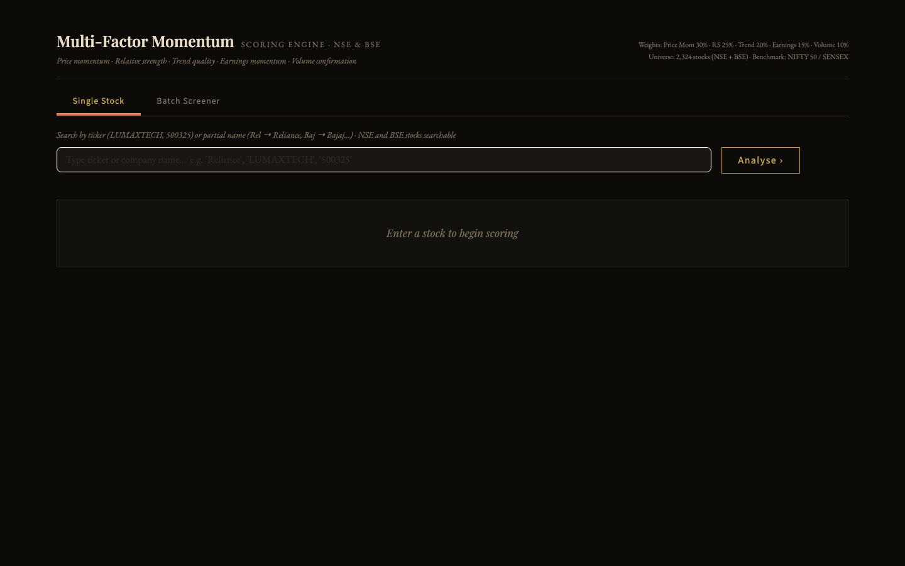

# MFM Momentum Engine v4

[](https://github.com/aadithyasumod/mfm_app/actions/workflows/ci.yml)   

A Streamlit app that scores any NSE or BSE equity from 0 to 100 on five momentum factors, with a single-stock view, a batch screener and end-of-day prices taken from the official NSE bhavcopy.



## What it does

- **Scores five factors** into one composite:

  | Factor | Weight | Inputs |
  |---|---|---|
  | Price momentum | 30% | 12-month (skip last month), 6M, 3M, 1M returns |
  | Relative strength | 25% | excess return vs benchmark, percentile rank across the universe |
  | Trend quality | 20% | % above 200/50 EMA, distance from 52-week high, ADX |
  | Earnings momentum | 15% | EPS and revenue growth YoY, earnings surprise |
  | Volume momentum | 10% | 20/50-day volume ratio, up/down volume, breakout volume |

- **Covers the full listed universe**: NSE equity master plus BSE active scrips, deduplicated by ISIN so a dual-listed company appears once under its NSE ticker; BSE-only stocks are kept.
- **Searches** by NSE symbol, BSE scrip code or partial company name.
- **Benchmarks** NSE stocks against NIFTY 50 and BSE stocks against SENSEX.
- **Caches prices** in the background:
  - *EOD prices*: the NSE bhavcopy (one request covers every NSE stock) with Yahoo Finance as the fallback for BSE-only names and indices.
  - *RS cache*: 12 months of history for the whole universe, built in a background thread (~8–15 min) so the app stays usable; progress shows in the sidebar.
- **Batch screener** with sector presets (NIFTY IT, Pharma, Auto, Defence…) or your own list, ranked by composite score.
- A watchlist and a light/dark theme toggle.

## Architecture

```
app.py (Streamlit)
  universe_builder  NSE EQUITY_L + BSE scrip API  ->  ISIN dedup  ->  universe.parquet
  price_cache       NSE bhavcopy (+ yfinance fallback)  ->  price_cache.parquet
  data_fetcher      yfinance history, indicators, RS cache  ->  rs_cache.parquet
  mfm_engine        pure scoring functions (no I/O)  ->  factor scores + composite
```

Caches are plain parquet files written atomically next to the code and rebuilt from the sidebar; they are not tracked in git.

## Requirements

- Python 3.10+
- Network access to nseindia.com, bseindia.com and Yahoo Finance

## Run locally

```bash
python3 -m venv venv && source venv/bin/activate
pip install -r requirements.txt
streamlit run app.py              # http://localhost:8501
```

On first run, open the sidebar and use **Refresh Universe**, **Build / Refresh RS Cache** and **Refresh Prices**. Without the RS cache, relative-strength rank falls back to the 50th percentile.

| Command | What it does |
|---|---|
| `streamlit run app.py` | start the app |
| `python -m pytest -q` | offline tests (price cache, universe dedup) |

## Project structure

```
app.py               Streamlit UI: single stock, batch screener, sidebar cache controls
mfm_engine.py        factor and composite scoring
data_fetcher.py      yfinance data layer, indicators, background RS cache
price_cache.py       bhavcopy-first EOD price cache with build status and audit metadata
universe_builder.py  NSE + BSE universe with ISIN dedup
nifty500_tickers.py  fallback universe and name -> ticker aliases
tests/               pytest suite
requirements.txt
```

## Caveats

- For analysis and education only; not investment advice.
- Earnings data comes from Yahoo's quarterly financials and is often missing for small caps; the factor still scores.
- The bhavcopy is published around 18:30–19:00 IST; before that the previous session's close is used.

## License

Copyright © 2026 aadithyasumod. All rights reserved.

No license is granted. The code is published for reference: you may view it, but not use, copy, modify or distribute it without written permission.
